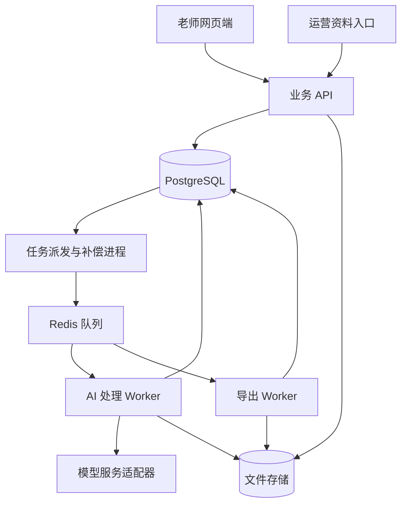

# 模块与架构设计

版本：V0.1。依据：项目根目录 PRD.md。本文是首期实施方案；不改变 PRD 已确认需求，补充规则均按技术建议记录。

## 1 架构决策

采用模块化单体：一个前端、一个后端代码库，共享业务模块；HTTP API、AI 处理 Worker 和导出 Worker 以独立进程运行。首期不拆微服务，不引入向量数据库或独立搜索集群。

5 位老师的交互并发较小，但一次上传可能产生多页识别、跨页合并、答案关联等任务。交互请求只创建持久任务并返回任务 ID，长任务交给后台执行。



数据库是业务与任务状态的事实来源，Redis 只承担消息传递。任务 Worker 使用数据库中的阶段产物续跑，浏览器退出不影响已提交任务。

## 2 模块划分

| 模块 | 负责内容与数据 | 对外能力 | PRD 对应 |
|---|---|---|---|
| identity 账号与访问 | 账号、角色、登录会话、对象访问权限 | 当前老师身份、运营角色检查 | 第 8 节 |
| curriculum 考点体系 | 版本化章节、考点、前置关系、难度规则 | 合法考点目录、前置知识闭包 | FR-03、04 |
| students 学生管理 | 学生信息、已学考点及进度版本 | 档案维护、进度查询和更新 | FR-05、06 |
| assets 资料与文件 | 文件、资料包、页面、裁剪图、来源 | 上传、页面排序、原图定位、授权下载 | FR-01、07 |
| question_bank 题库 | 题目版本、小问、答案、标签、难度、指纹 | 自动入库、候选检索、去重 | FR-02～04 |
| exams 考试与作答 | 考试、试题、作答、小问关联、批改信息 | 试题与答题卡关联、局部纠正 | FR-07、08 |
| diagnosis 错题诊断 | 错题判定、考点证据、原因、诊断版本 | 单次分析、多次考试考点汇总 | FR-09、10 |
| practice 练习组卷 | 配置、题目分配、练习版本、替换记录 | 默认抽题、进阶抽题、预览调整 | FR-11～14 |
| exports 文件输出 | 导出任务、模板版本、文件产物 | Word、PDF 题目版与答案版 | FR-15 |
| feedback 使用评价 | 预期符合度、评分、节省分钟数、意见 | 提交反馈、试用汇总 | FR-16 |

任务框架与 AI 适配器为基础设施，共享数据库连接、存储接口、结构化日志、模型调用和任务执行能力，不承接学情、进度或组卷业务决策。

模块可以读取其他模块公开的查询接口；写操作由数据所属模块执行。避免直接修改其他模块的表。首期允许同一数据库事务协调多个模块服务，不使用分布式事务。

## 3 页面与角色

老师端：登录、学生列表、学生详情及进度、考试材料上传、任务进度、原卷对照及错题分析、组卷配置、练习预览、导出记录、使用反馈。

运营端：资料包上传、处理列表、异常详情、重试入口。运营端用于上传和处理运维，不包含内容审核、标签批准或题目审核队列。

首期采用适配手机浏览器的网页上传和桌面备课页面，不开发原生 App 或小程序。

## 4 核心数据模型

| 实体 | 关键字段或约束 |
|---|---|
| user / session | role；老师账号由运营邀请创建；会话可撤销 |
| student | owner_teacher_id、学校、年级；所有查询检查归属 |
| curriculum_version / knowledge_point | 稳定 ID、章节、启用版本；前置关系禁止成环 |
| student_progress | student_id、curriculum_version、mastered_point_ids、revision；这里的 mastered 仅表示老师标记已学，不推断熟练程度 |
| source_bundle / asset / page | source_kind、资料用途、文件摘要、页序、尺寸、存储键、资料来源 |
| question / question_revision | 题干与小问结构、图形引用、答案、解析、来源区域、内容指纹、pipeline_version |
| question_tag / difficulty_assessment | 考点、前置知识、目录版本、0～100 难度分、等级、理由、模型及规则版本 |
| exam / exam_question / response | student_id、考试日期、满分及得分、排名；题号和小问路径、作答区域及可读批改分数 |
| response_link / diagnosis_revision | 关联状态、原图证据、错题状态、涉及考点、原因及未确定项 |
| practice / practice_item | 所用进度版本、诊断版本、配置、题目版本快照、归属目标考点、顺序 |
| export / feedback | practice_revision、模板版本、文件引用；符合预期、评分、节省分钟数、意见 |
| processing_job / job_step / outbox / ai_call | 状态、幂等键、租约、尝试次数、错误；模型耗时、用量与可获得的费用信息 |

考点关联、学生归属、题目选择等核心关系使用关系表和约束；JSONB 用于文档内容树、AI 原始结构和扩展信息，不以单个大 JSON 代替整套业务模型。

学生试卷及 AI 作答分析不自动回流共享题库。共享题库来自运营上传的教学资料，学生材料与题库材料分别管理。

## 5 题目与证据结构

题目以完整大题为存储和抽取单位，内部保留有序小问。内容由 paragraph、formula、image 和 subquestion 等节点构成；公式保存 LaTeX，几何图形保存原页裁剪图，不要求 AI 重绘。

每个识别元素保留 asset_id、page_id、页面规范化后的宽高、旋转及裁剪变换、归一化区域坐标。模型原始坐标通过适配器统一转换，不将不同供应商坐标直接混用。

跨页大题可引用多个来源区域；答案与作答均按题目及小问路径关联。相同题号不足以证明关联，必须结合资料包、题型、小问结构和内容。重号、漏页或矛盾分数保留为未确定。

模型提议的考点 ID 必须存在于当前目录；未知 ID 不自动创建新考点。前置知识先使用目录确定的关系，再允许 AI 补充目录中已有的相关 ID，经程序检查后使用。

## 6 自动加工与任务可靠性

题库流程：文件检查 → 页面规范化 → 页面识别 → 跨页拆题及合并 → 答案关联 → 考点标记与难度评分 → 结构和完整性校验 → 可检索入库。

题目状态：processing → ready 或 processing_failed。ready 由处理流程自动决定，不表示经过人工批准；失败后可修复文件或重新处理，仍不增加审核环节。

考试流程：规范化页面 → 识别试题、作答与批改 → 关联 → 错题与考点分析 → 汇总。考试允许 partial：已确定项目可查看和使用，未确定部分明确展示。老师纠正自己的考试识别结果属于产品交互，不是题库维护。

任务状态：queued、running、partial、succeeded、failed、cancelled。job_step 保存阶段结果。自动重试只针对超时、限流和暂时服务错误；不可用文件等永久错误直接暴露。建议每阶段最多 3 次自动尝试，再进入可手动重试状态。

以文件摘要、用途、处理版本和阶段组成幂等键；不跨老师复用私有材料。重复执行不重复插入题目，不覆盖人工纠正。重跑生成新版本，现有练习继续使用原版本。

业务记录与 outbox 在同一 PostgreSQL 事务提交；派发器投递后标记，投递可能重复，Worker 幂等消除影响。租约、心跳及过期恢复处理 Worker 中断；Redis 丢失消息时依据数据库未完成任务重新派发。外部模型调用超时后的重复计费无法完全消除，记录尝试次数并设费用限额。

## 7 组卷算法

组卷由程序执行，LLM 不直接决定最终题单。

1. 固定本次学生进度、诊断、考点目录及题目版本快照。
2. 以目标考点检索 ready 且答案可用的题目；所有涉及考点与前置知识必须属于已学集合。
3. 排除原考试题、已选题及同题重复版本。首期支持文件摘要与规范化内容指纹去重；扫描差异造成的近似重复需在 P0 验证识别策略，不声称完全去重。
4. 默认模式每考点 10 题，按难度分与该考点原错题的参考分距离排序。首版建议参考分取相关错题难度中位数；并列按持久随机种子打散。
5. 进阶模式按各考点、各难度的配额抽题，配额总和必须匹配。
6. 使用容量匹配分配题目：考点及难度槽位为需求，同一题目容量为 1，候选题为边；以难度距离为主要成本。避免逐考点贪心导致本可满足的配额出现假缺口。
7. 记录每题计数所属的一个目标考点。题目可有多个标签，但同卷只出现一次。
8. 仍有缺口时返回各槽位实际可用数和缺口，不自动放宽进度或进阶难度限制。

进度更新不静默修改已有练习。导出前检查当前进度版本；若旧练习涉及已撤回的考点，提示调整或重新生成后导出。保存的旧导出仍保留其生成时版本信息。

上述难度聚合、匹配算法、进度变更行为为技术建议，不替代 PRD 的待确认设计项。

## 8 导出与文件访问

题目和答案分别使用同一练习版本和编号映射生成 DOCX，再从对应 DOCX 转换 PDF。导出不重新抽题，不在导出时重新调用模型生成答案。

公式优先生成 Word 原生数学结构，图形嵌入裁剪图；使用统一中文字体和模板。导出 Worker 单独限制并发与内存，LibreOffice 使用任务独立配置目录。

原卷及产物均通过服务端权限检查后提供短期下载地址，或由授权下载接口流式返回。上传资料中的文本只作为识别数据，不能改变模型的任务指令或触发外部工具调用。

## 9 建议代码布局

```text
Teassistant/
  PRD.md
  README.md
  docs/
  apps/web/                   # React 网页
  backend/
    app/modules/              # 各业务模块
    app/infrastructure/       # 存储、模型、日志、数据库
    app/jobs/                 # 派发、重试、任务入口
    migrations/
    tests/
  contracts/                  # OpenAPI 生成的前端类型
  templates/                  # 练习及答案 DOCX 模板
  evals/                      # 本地样本索引、评测脚本和结果摘要
  infra/                      # Docker Compose 与部署说明
```

这是目标目录。当前 P0 离线实现位于 `backend/app/`、`backend/tests/`、`scripts/`、`contracts/p0-v1/` 和 `evals/fixtures/`；尚未实现网页、数据库与持久任务服务。学生原卷、凭据和真实样本不提交到源码仓库。
