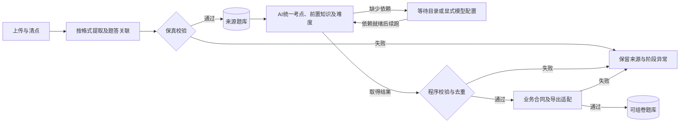

# 试题录入工作流

版本：V0.2，2026-11-11。依据 PRD FR-01～04、UC-01，以及[首批真实导入记录](acceptance/docx-bank-execution.md)。本文调整实施流程，不引入人工题库审核。阶段名和字段为后续实现设计；当前已实现范围见第 6 节，不将设计写成已上线能力。

## 1 主流程与职责

**批量上传 → 文件清点与配对 → 按格式提取 → 拆题与答案关联 → 自动保真校验 → 保存来源题库 → AI 统一考点、前置知识及难度 → 程序校验与去重 → 业务合同和导出适配 → 自动发布为可组卷题目。**

平台运营方负责提供原卷、答案或解析、资料来源，补传缺失文件并重试失败阶段。老师不承担题库标记、维护或批准职责。资料本身质量作为业务前提；这里检查的是系统是否完整、正确处理了资料。

来源题库可先供运营查看、检索、追溯；只有通过全部发布条件的题目才能被组卷模块查询。两阶段是同一自动流水线的持久阶段，不要求运营点击“批准入库”。

## 2 阶段输入、输出与失败处理

| 阶段 | 系统执行 | 退出条件与异常处理 |
|---|---|---|
| A 文件接收与清点 | 保存原件、用途、来源、摘要、资料包身份；清点格式、题型章节、可读题号及答案文件 | 原件不可读则报文件失败；预期题数无法确定时明确未知，不从成功输出反推分母；不固定每卷 25 题 |
| B 配对与提取 | 文件名标准化用于原卷/答案候选配对；结合资料包、正文题号、题型与内容验证关联。DOCX 优先读取 OOXML、表格、OLE 预览与图片；PDF/图片走适合其内容的提取和识别通路 | 同名、同题号不足以确认跨资料关联；冲突保留具体原因。不能用纯文字提取替代包含公式/图形的完整输入 |
| C 拆题与题答关联 | 从正式题型章节识别大题，保留小问与共用题干、跨页内容、表格；排除注意事项编号及解析内部步骤编号 | 漏题、重号、缺答案或关联冲突定位到题目；不补写答案。解析可选，缺解析本身不阻断有完整答案的题目 |
| D 保真校验 | 按源位置核对文字/图片顺序、媒体引用、表格、公式预览、显示尺寸及答案内容；保留 XML/关系和原件 | 缺媒体、丢表格、错误拆分或缺可用答案的题目失败；其他题可继续，批次显示部分完成 |
| E 来源保存与索引 | 保存完整内容、稳定来源身份和版本、指纹、已有解析、来源考点证据；提供原件与离线/运营预览 | 来源词条只作检索和 AI 线索。`imported` 不自动成为 `ready`；允许暂时没有考点标签及难度 |
| F AI 标记与评分 | 对所有结构成功题执行统一目录映射、必要前置知识分析、题目难度评分；保存依据、目录/规则/提示/模型版本与调用记录 | 有来源标签的题也必须校验与映射；无标签的题直接根据完整题干、图形及已有答案分析，不以词表命中作为 AI 调用前提 |
| G 程序校验与同题归并 | 校验输出结构、考点 ID 白名单、前置闭包、难度及版本；用内容指纹和同题身份处理重复来源 | 未知考点不能自动扩充官方目录，难度不能填默认值；无法确定同题关系时保留异常，不把不同来源静默覆盖或冒称近似去重完成 |
| H 业务适配与发布 | 转为版本化业务内容和来源合同，验证完整题干、小问、答案、图形及数学导出表示；自动产生可组卷版本 | 合同、引用或数学内容转换失败则停在具体阶段；成功题自动发布，无人工审核。教学进度、配额和原题排除仍在组卷时由程序执行 |

资料包可以指定原卷和答案的用途来消除文件分组歧义；这属于补全输入信息，不是逐题内容审核。没有答案或处理失败的题目仍保留来源与诊断信息，不进入组卷候选。

## 3 本次反馈形成的处理规则

### 3.1 原生资料优先，保留显示与语义两种表示

- DOCX 不先整卷截图再 OCR。按正文顺序读取段落和表格；保留原卷题干、解析版重复题干、答案及解析的各自来源。
- MathType 有源预览时先保存原 OLE 和预览，不因暂时没有 LaTeX 而丢弃整道题。浏览按 VML 的原显示尺寸、DrawingML 的 EMU 尺寸换算，不能直接用 PNG 像素尺寸。
- AI 输入必须包含可读的完整公式与几何图。若只能取得预览图，就提供题目渲染图或有序文本与图片，不能只提交缺公式的 `w:t` 文本。
- 公式语义表示与原图保留对应关系；转换结果另作校验，不覆盖源预览。正式导出仍优先原生数学结构；必要图像回退必须明确、可追踪且不丢内容。仅“浏览能显示”不能作为打印与编辑能力通过的证据。
- DOCX 的段落/表格/关系定位与 PDF/图片的页码区域分别保留。未获得可靠分页和区域坐标时，不编造页码或全页框来满足现有合同。

### 3.2 来源词条与统一考点分开

保存 `来源词条＋原句＋文档＋段落＋提取版本`，供检索和 AI 参考；正式考点只使用版本化湖南初中目录的合法 ID。

AI 同时读取完整题目、已有答案解析及来源词条，检查多考点和必要前置知识。来源词条不是答案，也不是唯一候选范围。所有题执行这一步，避免只给无词条题补标签、让已有词条绕过统一映射。没有来源词条不等于没有考点。

目录尚未准备好时等待目录依赖；当前合成目录不能冒充真实湖南目录。真实目录明确使用非合成标识，发布记录不能沿用 `synthetic` 默认模型版本或借合成结果补齐真实评分。模型返回未知 ID 时保留响应与异常，按配置做有界纠正；仍不合法则失败，不自动新建考点，不新增人工批准环节。

### 3.3 难度单独留痕，同一标准覆盖题库和学生原题

难度保存实际评分、依据、规则/锚题/模型版本，再由程序映射等级。已有解析中的“简单”“难点”只能作为线索，不能直接充当评分。现有 0～100 合同与分段草案继续作为研发基线，分段校准不在本轮冒写为用户已确认参数。

业务只使用 DeepSeek API；Codex CLI 仅在开发者显式选择时验证同一任务，不作为生产通路或失败回退。只记录实际调用的模型和结果，未执行时保持空值。当前单题抽取适配器并不等于已经实现了此批量标记阶段。

### 3.4 分层检查保真、发布与真实质量

1. 来源检查核对原件摘要、题号范围及媒体/表格，按“出现次数”统计复用图片；解析重复题干不计作第二道题。
2. 内容检查分别统计全源、题目内容块与浏览选择范围。不将合理省略的重复题干当作丢图，也不以保存原件代替检查题目块是否完整。
3. 发布前验证内容合同、合法标签/前置知识、非空真实评分、同题身份与导出资产。单题技术校验由程序执行；研发分层视觉抽查与真实样本评测用于验证实现，不变成逐题线上审核。
4. 结构合法和图片可加载不能证明考点、难度或数学语义正确。真实模型质量、实际 DOCX/PDF 与老师价值分别验收，不互相替代。

## 4 状态、依赖和重试

来源 V3 沿用 V2 的 `structure_status=imported/processing_failed`、批次状态及 `association_status=confirmed/unverified`；后续再增加语义加工和发布阶段记录。以下涉及语义和发布的状态仍为待实现语义，不直接向现有 `Question.status` 塞入新枚举：

| 语义 | 展示与下一步 |
|---|---|
| 来源处理成功 | 可浏览；`practice_ready=false`，未评分保持 `null`；继续语义加工 |
| 等待依赖 | 明确缺少目录、显式模型配置或业务适配能力；保存成功阶段，不反复重解析或无限重试 |
| AI 加工中 | 记录具体题目与阶段；部分题失败不删除成功题 |
| 加工/校验失败 | 显示失败代码、输入版本、尝试记录及可重跑阶段；不进入组卷 |
| 发布成功 | 生成符合业务合同的 `Question.status=ready`；来源层保存到该业务版本的映射 |

超时、限流及暂时服务错误按已有配置有界重试；永久文件错误不自动反复调用模型。更换目录、模型或规则后，从受影响阶段创建新结果；内容变化则使依赖该内容的标记、难度及发布结果失效并重算。

幂等键包含来源版本、内容摘要、阶段、目录与处理规则版本，避免重传或重复投递新增相同题目。同题不同来源保留来源关系；现有练习始终引用固定版本。任何真实材料和模型响应只留在私有存储，不写入源码。

## 5 统计与验收口径

批次分别报告：收到文件数、配对数、预期/提取题数、答案关联数、结构失败数、来源词条覆盖数、AI 已执行/失败/等待数、正式目录映射数、难度评分数、可组卷题数、重复来源数、调用耗时与可得用量。

本次 8 套、200 题、164 题来源词条和 48 个词条种类只是该批基线，不作为未来每批固定数量或质量门槛。来源标签覆盖率不得改名为考点准确率。模型失败与等待依赖必须留在原提交题目的分母中。

“可组卷”要求内容、答案、合法考点及必要前置知识、实际难度、来源与版本、去重身份、业务合同和导出所需内容都可用。学生进度、每考点默认 10 题、进阶配额及原题排除另由组卷程序检查，不能通过提前标记 ready 绕过。

## 6 当前批次如何继续

来源 V2 在 DOCX 原生提取、媒体保留与检索上增加了独立题号清点、保守题答确认、按章节题数核对、同段标记切分、可选解析、文件副本归并及单文件失败保留。支持的 OMML 公式可显示，不支持的公式或样式可见失败；结构指纹包含表格及数学结构。这些仍是来源处理能力，不能将研发审计脚本或一致性检查称作完整生产门禁、语义正确性证明或语义近似去重。PDF/图片通路、未确认关系的自动语义核验、业务发布和真实练习导出仍需实现与验证。

后续按以下顺序实施，不要求重新上传这 16 份资料：

1. 固定真实湖南考点目录与非合成标识、前置关系，以及语义阶段输出合同。来源身份须能关联后续题目版本。
2. 补齐来源层 `source-bank-v3` 到业务合同的桥接设计。当前 `ContentNode` 没有表格、公式图像回退元数据和原尺寸字段，`SourceRegion` 只接受页码与区域；先版本化扩展或提供经验证的转换，再同步识别、组卷、导出、评测和生成 Schema 的调用方，不能靠填假坐标或静默压平表格通过。
3. 从已有 200 题中选择覆盖公式、几何、小问、表格及无来源词条题的固定真实开发样本，显式执行一种模型通路验证标记和评分，再扩大到整批。开发抽样是工程验证，不是线上逐题批准。
4. 让全部 200 题进入同一语义加工流程：164 道将已有词条作为证据，36 道直接从完整题目和答案分析；每题保留成功、失败或等待原因。
5. 对加工成功题执行程序校验、同题关系和导出适配，自动发布符合条件的题目。报告实际可组卷数，不能预先承诺 200 题全部成功。
6. 按正式考点和难度统计可用库存，验证默认与进阶组卷、原题排除、进度过滤及真实 DOCX/PDF。库存不足时补充真实资料，不使用重复题或占位评分填充。

本流程最初修订时仅调整文档，后续来源 V2 的实现与实际结果见[修复执行记录](acceptance/ingestion-hardening-execution.md)。旧来源库保留，未执行真实模型评分，也未把现有题目改成 ready。后续实施任务与优先级见[开发计划](development-plan.md)。

关联核验 V3 在保留 V2 规则的基础上，增加完整原生 MathType 字节身份，并检查有序文字、表格、数学结构与媒体绑定。普通配图保持精确像素检查，未知差异仍自动保留未确认；不增加人工审核，也不自动变为 ready。本批 200 题固定工程目标为至少 190 题来源关联确认，见[合同与固定分母](acceptance/association-v3-contract.md)及[独立验收](acceptance/association-v3-review.md)。
